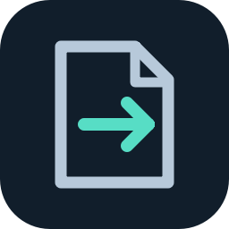

#  &nbsp; murums PS4 Unfself UI

**[Download for Windows](https://github.com/murums04/ps4-unfself-ui/releases/latest/download/ps4-unfself-ui-0.1.0-windows-x64-setup.exe)** · [Portable ZIP](https://github.com/murums04/ps4-unfself-ui/releases/latest/download/ps4-unfself-ui-0.1.0-windows-x64-portable.zip) · [All downloads](https://github.com/murums04/ps4-unfself-ui/releases/latest) · [Report a bug](https://github.com/murums04/ps4-unfself-ui/issues)

Convert fake-signed PS4 SELF files to ELF. Requires **unencrypted, uncompressed** files; no retail decryption or PKG extraction.

Community GUI by **murums**, based on [ps4_unfself by SocraticBliss](https://github.com/SocraticBliss/ps4_unfself). Research: Znullptr, flatz and zecoxao.

## Download

**[Release downloads](https://github.com/murums04/ps4-unfself-ui/releases/latest)** · 0.1.0

| Package | Use |
| --- | --- |
| [Windows installer](https://github.com/murums04/ps4-unfself-ui/releases/latest/download/ps4-unfself-ui-0.1.0-windows-x64-setup.exe) | Recommended. Install for your account; Start menu shortcut and uninstaller. No admin rights needed. |
| [Windows portable ZIP](https://github.com/murums04/ps4-unfself-ui/releases/latest/download/ps4-unfself-ui-0.1.0-windows-x64-portable.zip) | Extract the whole ZIP; run `PS4 Unfself UI.exe`. Keep `_internal` beside it. |
| `macos-arm64.dmg` / `macos-arm64-portable.zip` | **Apple Silicon · pending.** Drag the DMG app to Applications, or extract the ZIP. |
| `macos-x64.dmg` / `macos-x64-portable.zip` | **Intel Mac · pending.** Same installation options. |
| `linux-x64.deb` / `linux-x64-portable.tar.gz` | **Linux x64 · pending.** Install the DEB, or extract and run `./ps4-unfself-ui`. |

Package names start with `ps4-unfself-ui-0.1.0-` and include Python/Qt. Windows 11 tested; Windows 10 1809+ untested. Windows executables are unsigned; check `SHA256SUMS.txt`.

No Python installation needed. Use the installer or portable package above; GitHub's **Code → Download ZIP** contains source code.

macOS/Linux downloads follow after native builds and tests pass. See [platforms and builds](docs/building.md).

## Use

1. Drop files or select **Add files**.
2. Choose an **Output folder**; it defaults to the first input's folder.
3. Select **Convert to ELF**, then **Open output folder**. Use **Show details** for errors and paths.

Inputs stay read-only. Existing outputs get numbered alternatives: `eboot.elf`, `eboot (2).elf`. **Convert again** creates another copy. Cancel or close to discard the current partial file and keep completed results. Failed files do not stop the queue.

## Updates & privacy

The app checks GitHub on launch; retry through **About → Check now**. Download the matching portable archive in your browser and extract it to a new folder; choose **View release** for installers. Install updates yourself.

The anonymous HTTPS check sends connection metadata, not your file names or contents. No telemetry or uploads. Headless conversion makes no update requests.

## Details

Supports stripped ELF64, little-endian x86-64 layouts. See [format limits and test coverage](docs/verification.md), [build/CLI instructions](docs/building.md) and [release notes](docs/release-notes.md).

**GPL-3.0.** Keep [LICENSE](LICENSE), [third-party notices](THIRD_PARTY_NOTICES.md) and corresponding source when redistributing. Dependency licenses are in `licenses/`.

<a href="https://ko-fi.com/murums">Ko-fi</a>

