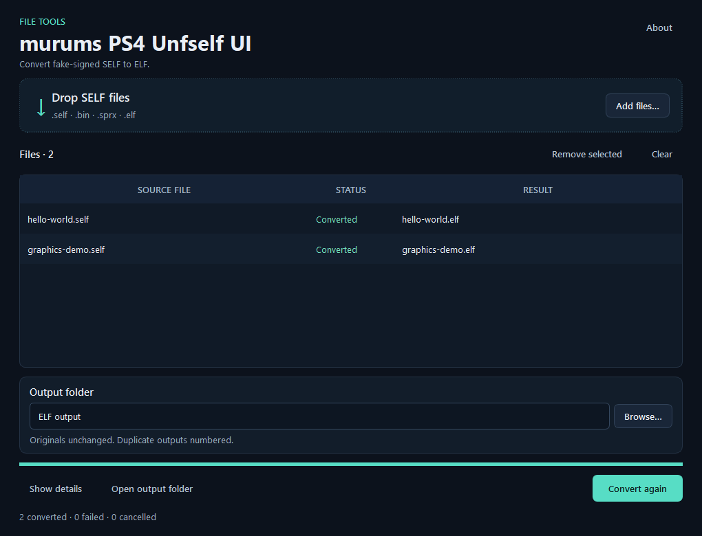

# murums PS4 Unfself UI

A desktop GUI for **ps4_unfself**: turn already fake-signed PS4 SELF executables back into ELF files. Windows packages are locally verified; native macOS and Linux builds and checks are prepared in CI and must pass before those packages are released.

Based on [ps4_unfself by SocraticBliss](https://github.com/SocraticBliss/ps4_unfself). This is an independent community project. Original research credits: **SocraticBliss, Znullptr, flatz and zecoxao**.



## Download and run

**[Release downloads](https://github.com/murums04/ps4-unfself-ui/releases/latest)**

Open this repository's **Releases** section and choose:

| Download | Use it when |
| --- | --- |
| `ps4-unfself-ui-0.1.0-windows-x64-setup.exe` | You want a Start menu entry and normal Windows uninstall support. |
| `ps4-unfself-ui-0.1.0-windows-x64-portable.zip` | You want to extract a folder and run `PS4 Unfself UI.exe` directly. |
| `ps4-unfself-ui-0.1.0-macos-arm64.dmg` / `-macos-x64.dmg` | On macOS, drag the app to Applications. Separate Apple Silicon and Intel builds. Native verification pending. |
| `ps4-unfself-ui-0.1.0-macos-arm64-portable.zip` / `-macos-x64-portable.zip` | Extract and run the macOS `.app` bundle. Native verification pending. |
| `ps4-unfself-ui-0.1.0-linux-x64.deb` | Install with the package manager on Ubuntu 22.04+ or a compatible Debian-based system. Native verification pending. |
| `ps4-unfself-ui-0.1.0-linux-x64-portable.tar.gz` | Extract the complete folder and run `./ps4-unfself-ui`. Native verification pending. |

The portable ZIP must be extracted completely. Keep the `_internal` folder beside the EXE. Both downloads include Python and Qt. Installation is for the current Windows user and does not require administrator rights. An optional desktop shortcut is offered during setup.

Targets: Windows 10 version 1809+ / Windows 11 x64; macOS 13+ on Apple Silicon or Intel; Linux x64 with glibc 2.35+ and an X11/XWayland desktop, with Ubuntu 22.04 as the build baseline. Only Windows 11 x64 has been tested locally so far. The native workflow tests each macOS architecture and Linux on its own runner; prepared CI is not a claim that these builds have passed.

Windows executables are unsigned. macOS bundles use an ad-hoc signature, with no Apple Developer ID or notarization; Gatekeeper may block a downloaded build until the user allows it in Privacy & Security. SHA-256 checksums accompany each platform's packages. The packaged applications include Python and Qt.

On Linux, install the `.deb` with `sudo apt install ./ps4-unfself-ui-0.1.0-linux-x64.deb` and remove it with `sudo apt remove ps4-unfself-ui`. The package manager installs the required desktop libraries. Portable users need the same dependencies listed in `scripts/package_posix.py`. Use a local output filesystem that supports hard links; an unsupported destination fails without replacing existing files.

## Convert files

1. Drop files into the window, or use **Add files**. You can select multiple files.
2. Choose an **Output folder**. The first input file's folder is selected initially.
3. Select **Convert to ELF**. Each row shows its result; **Show details** includes full paths and errors.
4. Use **Open output folder** to find the generated ELF files.

Input files are opened read-only. Existing outputs are preserved: `eboot.elf`, `eboot (2).elf`, and so on. Cancelling or closing during conversion removes the current incomplete output and keeps completed files. Failed files do not stop the rest of the queue. **Convert again** runs the listed files again and creates new numbered outputs.

## Supported inputs and limits

- Already fake-signed, **unencrypted and uncompressed** PS4 SELF files with ELF64 little-endian x86-64 data. Names such as `.self`, `.bin`, `.sprx` and `.elf` are accepted; the content is validated.
- This tool **does not decrypt retail executables**, obtain keys, unpack PKG files, or make encrypted inputs usable.
- Only supported stripped ELF layouts are reconstructed. ELF section tables, conflicting/overlapping data segments and program segments without matching SELF data are rejected explicitly.
- Reconstructed files are limited to 4 GiB and to a conservative expansion bound of `max(64 MiB, 16 × input size)`.
- SELF signatures/digests are not authenticated. Successful conversion means structural reconstruction, not a guarantee that the program runs on a console or emulator.
- Verification includes synthetic fixtures and a user-supplied real-world SELF. Its reconstructed ELF matched the user's existing reference byte-for-byte, including the library-version trailer. This does not establish compatibility with every game or executable.

## Why this UI has its own conversion core

The original Python script provides the format baseline. This version separates the converter from the interface, maps data using the embedded segment index, validates file bounds and writes outputs without overwriting existing files. Equal-sized segments are deliberately tested because size-only matching can select the wrong bytes.

The application runs locally. It has no telemetry, network requests, persistent settings, updater, or shell/file-type associations.

## Build from source

Use Python **3.12** matching the target architecture. Build on the target operating system; PyInstaller does not cross-compile. On Windows, also use PowerShell and Inno Setup (tested with **7.1.0**).

```powershell
python -m venv .venv
.venv\Scripts\python.exe -m pip install -r requirements-build.txt
.venv\Scripts\python.exe -m pip install --no-deps -e .
.venv\Scripts\python.exe -m unfself_ui
```

Run checks and build the distributions:

```powershell
.venv\Scripts\python.exe -m pytest -q
powershell -ExecutionPolicy Bypass -File scripts\build.ps1 -IsccPath "C:\Path\To\Inno Setup\ISCC.exe"
.venv\Scripts\python.exe scripts\verify_packages.py
.venv\Scripts\python.exe scripts\verify_release.py
```

`packages/` contains the deliverables. `verify_packages.py` temporarily installs into a unique `.work/package-check-*/installed` directory, checks the packaged conversion, repeats setup to test same-version upgrade handling, then uninstalls. It refuses to run if this application is already installed. It checks Start menu and uninstall registration cleanup. Do not run that check while using another installed copy.

On macOS or Linux:

```sh
python3 -m venv .venv
.venv/bin/python -m pip install -r requirements-build.txt
.venv/bin/python -m pip install --no-deps -e .
.venv/bin/python -m unfself_ui
.venv/bin/python scripts/build_posix.py
.venv/bin/python scripts/verify_posix.py
```

macOS packaging uses Xcode command-line tools, `codesign`, `ditto` and `hdiutil`. Linux packaging uses `dpkg-deb`; verification also uses `desktop-file-validate`. See `.github/workflows/build.yml` for the Linux desktop dependencies and `xvfb-run` setup on a headless runner. Only disposable Linux CI runners should use `verify_posix.py --install`, which explicitly installs, reinstalls and purges the package using sudo. Normal verification extracts the Debian payload without a system installation.

CI is configured to build and verify Windows x64, Linux x64, macOS arm64 and macOS x64 packages, then upload workflow artifacts. It **does not publish releases**. Native checks include exact fixture reconstruction and the real Qt event loop, not just executable creation. Publication is a separate owner action. See [release notes](docs/release-notes.md), [verification](docs/verification.md) and [release checklist](docs/publication.md).

### Optional headless conversion

The same converter can be used without opening a window:

```powershell
.venv\Scripts\python.exe -m unfself_ui --convert eboot.bin --output-dir output --report result.json
```

The packaged EXE accepts the same arguments. It is a windowed executable, so use `--report` to capture its results and wait for process completion from your shell. The output folder must exist; a report file must not already exist. Exit code `0` means all conversions succeeded; `1` means at least one failed.

## License and attribution

GPL-3.0. See [LICENSE](LICENSE) and [THIRD_PARTY_NOTICES.md](THIRD_PARTY_NOTICES.md). Keep these notices and the corresponding source available when redistributing. Python, Qt/PySide6 and other bundled components have their own licenses, included under `licenses/`.

Upstream baseline: `SocraticBliss/ps4_unfself` commit `794ed5460ea6d82def0ed661d05d8171fa09ce1b`. Format interpretation was cross-checked against [OpenOrbis create-fself](https://github.com/OpenOrbis/create-fself), which credits flatz's SELF research.

